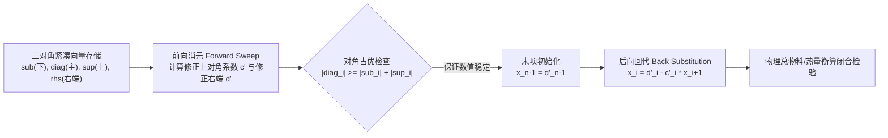

# 用 C# 学数值方法（二）：三对角方程组与 Thomas 算法

化工过程模拟中，多级逆流传质过程（如吸收塔、萃取塔逐级衡算）、一维热传导差分方程以及管式反应器对流-扩散系统的离散化模型，常表现为高度稀疏、结构规则的矩阵。**非零元素仅分布在主对角线及上下两侧，其余全为零**。

用常规稠密消元或 LU 分解处理这类矩阵，会带来大量无效零元素浮点运算。计算复杂度高达 $O(n^3)$。更糟的是“填元（Fill-in）”效应，会让稀疏矩阵退化为稠密矩阵，撑爆内存。针对其带状拓扑，利用 **Thomas 算法（三对角矩阵算法 TDMA, Tridiagonal Matrix Algorithm）**，可将时间和空间复杂度降至 **$O(n)$**。

直接分析纯 C#（.NET 10）实现的无冗余紧凑 TDMA 算法。结合多级逆流萃取平衡、精馏塔 Wang-Henke 算法及管式传热差分模型，拆解其在开源流程模拟器 DWSIM 精馏核心求解器中的实战。

---

## 算法逻辑架构

Thomas 算法的核心机制分为前向消元与后向回代。控制流如下：

> 💡 **交互式架构看板**：可在浏览器中打开 [02-thomas.workflow.html](/diagrams/02-thomas.workflow.html) 查看基于 Archify 生成的动态架构看板。



---

## 算法数学推导：紧凑消元与回代递推式

设一维 $n$ 阶三对角线性方程组表示为：
$$a_i x_{i-1} + b_i x_i + c_i x_{i+1} = d_i \quad (i = 0, 1, \dots, n-1)$$
其中边界条件为 $a_0 = 0$，$c_{n-1} = 0$。用矩阵展开表示为：
$$
\begin{bmatrix}
b_0 & c_0 & & & \\
a_1 & b_1 & c_1 & & \\
& a_2 & b_2 & c_2 & \\
& & \ddots & \ddots & \ddots \\
& & & a_{n-1} & b_{n-1}
\end{bmatrix}
\begin{bmatrix} x_0 \\ x_1 \\ x_2 \\ \vdots \\ x_{n-1} \end{bmatrix}
=
\begin{bmatrix} d_0 \\ d_1 \\ d_2 \\ \vdots \\ d_{n-1} \end{bmatrix}
$$

### 1. 前向消元（Forward Sweep）
目标：消去下对角线元素 $a_i$，主对角线元素归一化为 1。
- **首行初始化 ($i = 0$)**：
  $$c'_0 = \frac{c_0}{b_0}, \qquad d'_0 = \frac{d_0}{b_0}$$
- **逐行递推消元 ($i = 1, 2, \dots, n-1$)**：
  用第 $i-1$ 行消去第 $i$ 行的下对角项 $a_i$。主对角线有效主元记为 $m_i$：
  $$m_i = b_i - a_i \cdot c'_{i-1}$$
  消元后等效上对角系数 $c'_i$ 与修正常数项 $d'_i$ 为：
  $$c'_i = \frac{c_i}{m_i}, \qquad d'_i = \frac{d_i - a_i \cdot d'_{i-1}}{m_i}$$

### 2. 后向回代（Back Substitution）
消元完成。最后一个方程直接给出解 $x_{n-1}$，其余未知数自底向上逐级代入求解。
- **末项直接提取**：
  $$x_{n-1} = d'_{n-1}$$
- **向上回代求解 ($i = n-2, n-3, \dots, 0$)**：
  $$x_i = d'_i - c'_i \cdot x_{i+1}$$

### 3. 数值稳定性与免选主元充要条件
稠密矩阵求解若不选主元，遇到小主元时舍入误差会急剧扩散。Thomas 算法不同。若矩阵满足**严格行对角占优（Strictly Diagonally Dominant）**：
$$|b_i| > |a_i| + |c_i| \quad (\forall i)$$
数学上可证：**递推分母 $|m_i| > |c_i| \ge 0$，分母绝不为 0，且修正系数 $|c'_i| < 1$**。前向消元与回代中的浮点舍入误差不会放大，反而会被指数衰减抑制。满足对角占优的三对角系统**无需进行耗时的行交换选主元**。

---

## 算力降维账本：$O(n^3)$ vs $O(n)$

普通高斯消元、LU 分解与 Thomas 算法的计算复杂度对比：

| 指标 | 稠密 Gauss 消元 | 稠密 LU 分解 | Thomas 算法 (TDMA) |
| :--- | :--- | :--- | :--- |
| **内存存储空间** | $n^2$ 矩阵存储 | $n^2$ 矩阵存储 | **$4n$（仅存 3 对角向量与 1 常数向量）** |
| **消元乘除法次数** | $\approx \frac{1}{3} n^3$ | $\approx \frac{1}{3} n^3$ | **$\approx 3n$ 次** |
| **回代乘除法次数** | $\approx \frac{1}{2} n^2$ | $\approx n^2$（前代+回代） | **$\approx 2n$ 次** |
| **总计算复杂度** | **$O(n^3)$** | **$O(n^3)$** | **$O(n)$** |
| **$n = 100$ 运算量** | $\sim 3.8 \times 10^5$ 次 | $\sim 3.4 \times 10^5$ 次 | **$\sim 500$ 次（提速 700+ 倍）** |
| **$n = 10,000$ 运算量** | $\sim 3.3 \times 10^{11}$ 次 (卡死) | $\sim 3.3 \times 10^{11}$ 次 | **$\sim 5 \times 10^4$ 次（几毫秒内完成）** |

---

## 工程实战案例：多级逆流传质与换热网络

### 案例一：10 级逆流液液萃取塔物料衡算
考虑标准 10 平衡级两相逆流萃取系统（参考 Jorquera & Gelmi 2026/2027, Example 1.2）：
- **水相（重相）**：流量 $F_1 = 100\text{ kg/h}$。第 1 级顶部进塔，入口溶质质量分数 $y_{\text{in}} = 0.05$。
- **有机相（轻相/萃取剂）**：流量 $F_2 = 10\text{ kg/h}$。第 10 级底部逆流进入，纯溶剂入口 $x_{\text{in}} = 0$。
- **相平衡关系**：各平衡级溶质服从线性分配比：$x_j = K \cdot y_j$。分配常数 $K = 4.0$。

#### 物理衡算与矩阵构建
对第 $j$ 平衡级进行溶质稳态物料衡算（输入 = 输出）：
$$F_1 y_{j-1} + F_2 x_{j+1} = F_1 y_j + F_2 x_j$$
代入相平衡关系 $x_j = K y_j$，整理得：
$$F_1 y_{j-1} - (F_1 + F_2 K) y_j + F_2 K y_{j+1} = 0$$
全式除以 $F_1$，定义萃余比系数 $\alpha = \frac{F_2 K}{F_1} = \frac{10 \times 4.0}{100} = 0.4$：
$$y_{j-1} - (1 + \alpha) y_j + \alpha y_{j+1} = 0$$

处理塔顶（$j=1$）与塔底（$j=10$）边界条件：
- **第 1 级（顶端）**：$F_1 y_{\text{in}} + F_2 K y_2 = (F_1 + F_2 K) y_1 \implies -(1+\alpha) y_1 + \alpha y_2 = -y_{\text{in}}$
- **第 $j$ 级（中间段 $j=2 \dots 9$）**：$y_{j-1} - (1+\alpha) y_j + \alpha y_{j+1} = 0$
- **第 10 级（底端）**：$F_1 y_9 + F_2 x_{\text{in}} = (F_1 + F_2 K) y_{10} \implies y_9 - (1+\alpha) y_{10} = -\frac{F_2}{F_1} x_{\text{in}}$

映射到三对角紧凑向量：
- 下对角线 `sub`：全为 $1.0$。
- 主对角线 `diag`：全为 $-(1 + \alpha) = -1.4$。
- 上对角线 `sup`：全为 $\alpha = 0.4$。

**对角占优校验**：每行 $|diag_j| = 1.4 \ge |sub_j| + |sup_j| = 1.0 + 0.4 = 1.4$。边界两端严格对角占优（$1.4 > 0.4$ 与 $1.4 > 1.0$）。满足收敛与稳定条件。

---

### 案例二：多组分精馏中的 Wang-Henke 泡点法
石油化工分离中（参考 Perry 化工手册第 13 节与 Wang & Henke 1966 经典论文），多元非理想精馏塔的逐板物料衡算即多组联立的三对角方程组。

对组分 $i$，假设外层迭代已知全塔 $N$ 块塔板的气液平衡常数 $K_{i,j}$、液相流量 $L_j$ 与气相流量 $V_j$。该组分在塔板 $j$ 上的物料衡算式为：
$$V_{j+1} y_{i,j+1} + L_{j-1} x_{i,j-1} - (V_j y_{i,j} + L_j x_{i,j}) = 0$$
利用平衡关系 $y_{i,j} = K_{i,j} x_{i,j}$，全部用液相摩尔分数 $x_{i,j}$ 表示：
$$L_{j-1} x_{i,j-1} - (V_j K_{i,j} + L_j) x_{i,j} + (V_{j+1} K_{i,j+1}) x_{i,j+1} = 0$$
对每个组分 $i$，这都是严格的 $N$ 阶三对角矩阵。50 块塔板、30 个烃类组分的催化裂化分馏塔模拟中，每次内层迭代需解 30 次维度 50 的三对角方程。用 Thomas 算法只需几微秒。

---

## 建模边界与物理自洽性分析（避坑）

将物理方程转为三对角矩阵，容易踩中一个陷阱：**混淆两相传递的流动通量基准**。
某些教学实现中，误将两边通量同除以各自相流量，导致下对角线错写成 $\alpha$：
$$\alpha y_{j-1} - (1+\alpha) y_j + \alpha y_{j+1} = 0 \quad (\text{错误写法！})$$
方程求解器照样能吐出看起来平滑的数值解。但代回物理守恒定律进行总体核算：
$$\text{输入溶质} = F_1 y_{\text{in}} + F_2 x_{\text{in}} \neq \text{输出溶质} = F_1 y_{10} + F_2 x_1$$
衡算误差可达 $30\% \sim 50\%$。代数求解不等于物理正确。**算法只管代数自洽，证明真伪还得靠物理守恒检验。**

---

## C# 紧凑实现

代码特点：
- **四向量紧凑存储**：不分配二维数组，内存占用 $O(n)$。
- **防污染就地解耦**：消元使用独立中间向量，保留原始参数。
- **双重物理闭合验证**：包含逐级微观衡算与总宏观衡算残差检查。

```csharp
using System;
using System.Linq;

// =========================================================================
// 《用 C# 学数值方法（二）：三对角方程组与 Thomas 算法》
// 算例：10 级逆流两相萃取塔物料衡算 (Jorquera & Gelmi 2026/2027)
// =========================================================================

const double F1 = 100.0;   // 水相流量 (kg/h)，从第 1 级顶部进料
const double F2 = 10.0;    // 有机相流量 (kg/h)，从第 10 级底部逆流进入
const double yin = 0.05;   // 入口水相溶质质量分数 (5 wt%)
const double xin = 0.0;    // 入口有机相溶质质量分数 (纯萃取剂)
const double K = 4.0;      // 平衡分配系数 x = K * y
const int n = 10;          // 级数

double alpha = F2 * K / F1; // 萃余比参数 = (10 * 4.0) / 100 = 0.4

// 紧凑四向量存储
var sub = new double[n];     // 下对角线 a_i (sub[0] 不参与)
var diag = new double[n];    // 主对角线 b_i
var sup = new double[n];     // 上对角线 c_i (sup[n-1] 不参与)
var rhs = new double[n];     // 右端常数 d_i

Array.Fill(sub, 1.0);
Array.Fill(diag, -(1.0 + alpha));
Array.Fill(sup, alpha);

rhs[0] = -yin;
rhs[n - 1] = -(F2 / F1) * xin;

// 1. 调用 Thomas 算法求解
double[] y = SolveThomas(sub, diag, sup, rhs);

Console.WriteLine("===============================================================");
Console.WriteLine("10 级逆流液液萃取塔各平衡级稳态浓度分布:");
Console.WriteLine("===============================================================");
Console.WriteLine("级号     水相质量分数 y_j      有机相质量分数 x_j (K*y_j)");
Console.WriteLine("---------------------------------------------------------------");
for (int j = 0; j < n; j++)
{
    Console.WriteLine($"  {j + 1,2}          {y[j],9:F6}               {K * y[j],9:F6}");
}

// 2. 逐级微观物料衡算残差验证
double maxStageResidual = 0.0;
for (int j = 0; j < n; j++)
{
    double waterIn = (j == 0) ? F1 * yin : F1 * y[j - 1];
    double solventIn = (j == n - 1) ? F2 * xin : F2 * K * y[j + 1];
    double totalOut = (F1 + F2 * K) * y[j];
    double res = Math.Abs(waterIn + solventIn - totalOut);
    maxStageResidual = Math.Max(maxStageResidual, res);
}

// 3. 全塔宏观总物料衡算闭合检验
double soluteIn = F1 * yin + F2 * xin;
double soluteOut = F1 * y[n - 1] + F2 * (K * y[0]);
double totalBalanceDiff = Math.Abs(soluteIn - soluteOut);

Console.WriteLine("---------------------------------------------------------------");
Console.WriteLine($"逐级微观物料衡算最大残差 : {maxStageResidual:E4} kg/h");
Console.WriteLine($"全塔宏观溶质输入总率     : {soluteIn:F6} kg/h");
Console.WriteLine($"全塔宏观溶质输出总率     : {soluteOut:F6} kg/h");
Console.WriteLine($"全塔总物料衡算闭合差     : {totalBalanceDiff:E4} kg/h (严格物理闭合)");
Console.WriteLine("===============================================================");

// =========================================================================
// 核心函数：三对角矩阵算法 (Thomas Algorithm / TDMA)
// =========================================================================
double[] SolveThomas(double[] a, double[] b, double[] c, double[] d)
{
    int len = d.Length;
    var cPrime = new double[len];
    var dPrime = new double[len];

    // 前向消元：首行
    cPrime[0] = c[0] / b[0];
    dPrime[0] = d[0] / b[0];

    // 前向消元：递推
    for (int i = 1; i < len; i++)
    {
        double m = b[i] - a[i] * cPrime[i - 1];
        if (Math.Abs(m) < 1e-15)
            throw new InvalidOperationException($"TDMA 在第 {i} 节点遭遇对角线奇异零主元。");

        cPrime[i] = c[i] / m;
        dPrime[i] = (d[i] - a[i] * dPrime[i - 1]) / m;
    }

    // 后向回代
    var x = new double[len];
    x[len - 1] = dPrime[len - 1];
    for (int i = len - 2; i >= 0; i--)
    {
        x[i] = dPrime[i] - cPrime[i] * x[i + 1];
    }

    return x;
}
```

---

## 工业实践：DWSIM 源码中的 TDMA

开源流程模拟器 **DWSIM**（GPLv3）中，多级平衡分离塔（吸收、解吸、精馏等）核心求解器大量调用 TDMA。在严格精馏塔求解模块 `RigorousColumnSolvers/Tomich.vb` 中，内置的 `TDMASolve` 方法与上文设计一致：

```vb
' 摘自 DWSIM 源码：RigorousColumnSolvers/Tomich.vb
Public Shared Sub TDMASolve(n As Integer, a As Double(), b As Double(), c As Double(), d As Double(), ByRef x As Double())
    Dim id As Double
    c(0) = c(0) / b(0)
    d(0) = d(0) / b(0)
    For i As Integer = 1 To n - 1
        id = b(i) - c(i - 1) * a(i)
        c(i) = c(i) / id
        d(i) = (d(i) - d(i - 1) * a(i)) / id
    Next
    x(n - 1) = d(n - 1)
    For i As Integer = n - 2 To 0 Step -1
        x(i) = d(i) - c(i) * x(i + 1)
    Next
End Sub
```

在泡点循环计算（`BubblePoint2.vb`）中，DWSIM 通过 `Parallel.For(0, nComponents, ...)` 并行分发 `TDMASolve`。多核 CPU 下，几十个组分全塔物料衡算求解耗时仅需几毫秒。

---

## 参考文献

1. **Jorquera, H., & Gelmi, C. A. (2026/2027).** *Numerical Methods in Chemical Process Engineering Using Python*. Springer Cham. Example 1.2（10 级逆流液液萃取塔衡算）。
2. **Wang, J. C., & Henke, G. E. (1966).** *Tridiagonal Matrix for Distillation*. Hydrocarbon Processing, 45(8), 155–163.（多组分精馏三对角矩阵法奠基性文献）。
3. **Perry, R. H., & Green, D. W.** *Perry's Chemical Engineers' Handbook* (7th/8th Edition). McGraw-Hill. Section 13: Distillation Modeling & Tridiagonal Methods.
4. **Wiley. (2020).** *Applied Numerical Methods Using MATLAB*. Section 2.5: LU Decomposition of a Tridiagonal Matrix.